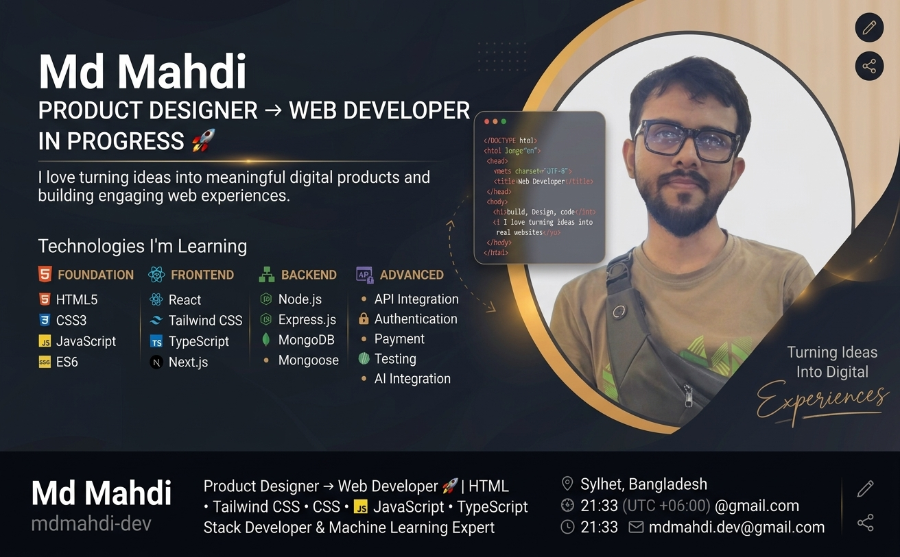

<!-- ======================= BANNER ======================= -->

  

<!-- ======================= INTRO ======================= -->

<h1 align="center">Hi 👋, I'm Mahdi</h1>

<h3 align="center">Web Developer | React & Next.js</h3>

  Building responsive, user-friendly web applications with modern web technologies.

  
  

---

## 👨‍💻 About Me

I'm a web development learner focused on building practical projects and strengthening my skills in modern frontend development. I enjoy turning ideas into functional web experiences and continuously improving through hands-on coding.

* 💻 Learning and building with **React, Next.js, and TypeScript**
* 🚀 Developing responsive web applications and working with REST APIs
* 🧩 Practicing JavaScript, TypeScript, and problem-solving
* 🎓 Pursuing my Master's degree at MC College
* 🎯 Working toward becoming a **Full-Stack Software Developer**
* 🤖 Interested in exploring Machine Learning in the future

---

## 🛠️ Tech Stack

### Frontend Development

  

### Tools & Platforms

  

### Currently Exploring

  

---

## 🚀 Featured Projects

### 🧩 Dev Stack Builder

A responsive application for exploring technologies and building a personal development stack. Includes technology cards and interactive stack management.

* **Technologies:** React, TypeScript, Tailwind CSS, Vite
* 🌐 **[Live Demo](https://dev-stack-two-flame.vercel.app/)**
* 💻 **[Source Code](https://github.com/mdmahdi-dev/dev-stack)**

### 🏋️ FitLog

A workout library and planning application that lets users browse workouts, explore exercise details, build a workout plan, save workouts, and track completed exercises.

* **Technologies:** Next.js, React, TypeScript, Tailwind CSS, REST API
* 🌐 **[Live Demo](https://fit-log-rho-six.vercel.app/)**
* 💻 **[Source Code](https://github.com/mdmahdi-dev/fit-log)**

---

## 📚 Currently Learning

* Strengthening React and Next.js fundamentals
* Building typed, reusable components with TypeScript
* Working with APIs, JSON, and CRUD operations
* Improving responsive UI development with Tailwind CSS
* Exploring backend development and database integration

---

## 📊 GitHub Statistics

  
  

  

---

## 🤝 Connect With Me

  
  <!-- Add your LinkedIn URL below after confirming your public profile URL. -->
  <!--
  
  -->

---

  <i>Learn continuously. Build consistently. Improve every day. 🚀</i>

